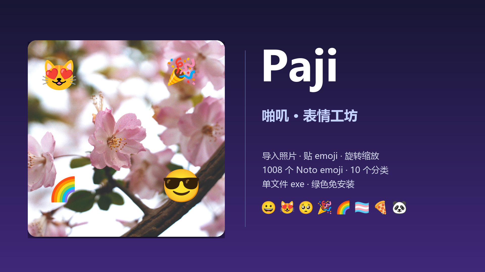
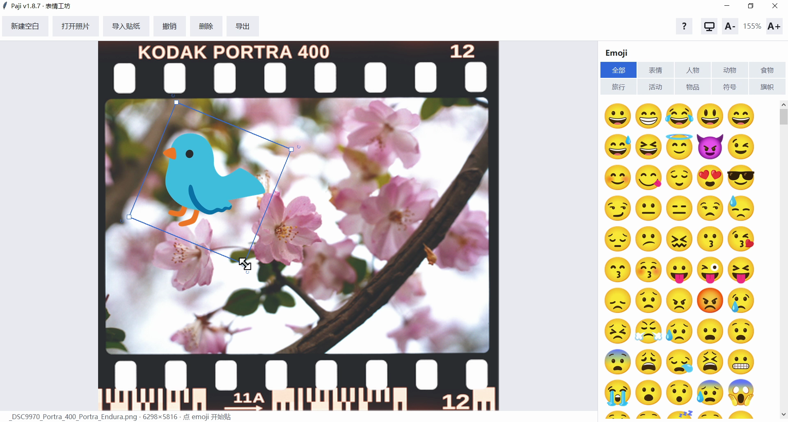

# Paji · 啪叽 v1.8.7 😻

> Windows 表情工坊：打开照片或新建空白画布，往上贴 emoji / PNG 贴纸，导出原图分辨率。

**单文件 exe · 绿色免安装**



## 界面

实际使用效果（照片：KODAK PORTRA 400 胶片扫描，贴纸：选中后可拖动 / 旋转 / 缩放）：



---

## 功能

### 画布
- **打开照片**：JPG / PNG / WebP / BMP / TIFF / HEIC / AVIF（取决于本机编解码器）
- **新建空白画布**：1080² / 1920×1080 / 2048² / A4 300dpi，可自定义宽高，背景白 / 透明 / 深灰
- **视图缩放**：`Ctrl+滚轮` 以光标为中心，20%–600%
- **视图平移**：中键拖动；`0` 复位到适应窗口
- 画布空白处**双击**也能选照片

### 贴纸
- **1008 个 Noto emoji**，10 个分类：表情 / 人物 / 动物 / 食物 / 旅行 / 活动 / 物品 / 符号 / 旗帜
- **导入自己的 PNG** 贴纸
- **PS 风格变换框**：四角拖拽缩放，角外侧拖拽旋转，顶部 ↻ 图标提示
- **层级控制**：拖动即置顶；右键菜单（置顶 / 上移 / 下移 / 置底 / 删除）；`Alt+拖到贴纸上`换层
- **防误缩**：只有光标停在贴纸上时滚轮才缩放

### 导出与色彩
- **6 种格式**：PNG / JPEG / WebP（无损）/ AVIF / TIFF（LZW）/ BMP
- **原图分辨率**合成，与屏幕缩放无关
- **ICC 校色**：读取时把 Adobe RGB / ProPhoto 转 sRGB，导出时嵌入 sRGB 配置

### 界面
- 高 DPI 适配（125% / 150% / 200% 清晰）
- 主题三选一：浅色 / 深色 / 跟随系统（🌙 ☀️ 🖥️）
- 界面字号可调：`A-` / `A+`，设置自动保存
- `?` 按钮或 `F1` 打开快捷键总览

## 快捷键

| 键 | 作用 |
|---|---|
| `Ctrl+O` | 打开照片 |
| `Ctrl+S` | 导出 |
| `Ctrl+Z` | 撤销（40 步） |
| `Ctrl` + 滚轮 | 视图缩放 |
| 中键拖动 | 平移视图 |
| `0` | 视图复位 |
| 拖拽贴纸 | 移动并置顶 |
| 四角方块 / 角外侧 | 缩放 / 旋转贴纸 |
| `[` / `]` | 旋转 ±5° |
| `Ctrl+]` / `Ctrl+[` | 置顶 / 置底 |
| `Alt` + 拖到贴纸上 | 移到那层之上 |
| 右键贴纸 | 层级菜单 / 删除 |
| `Delete` / `Esc` | 删除 / 取消选中 |
| `Ctrl+T` | 切换主题 |
| `Ctrl+ +` / `Ctrl+ -` | 界面字号 |

设置文件：`%APPDATA%\Paji\config.json`

---

## 首次准备素材

仓库不包含 21 MB 的 emoji 图片，克隆后先下载：

```powershell
python tools_fetch_emoji.py     # 下载 Noto emoji + 国旗
python tools_build_thumbs.py    # 生成缩略图图集
python paji.py                  # 运行
```

## 开发

```powershell
python paji.py                              # 跑源码
python paji.py --selftest selftest.png      # 无窗口自检
python tools_build_emoji_list.py            # 生成 emoji 清单
python tools_make_icon.py                   # 生成图标
python tools_make_intro.py                  # 生成介绍图
python compat_test.py                       # 兼容性测试
```

### 打包

双击 `build.cmd`，或：

```powershell
.buildenv\Scripts\python.exe -m PyInstaller --noconfirm --clean "Paji.spec"
```

产物 `dist\Paji v1.8.7.exe`（42 MB），打包后自动归档到 `releases\` 与 `versions\`。

---

## 兼容性

| 项目 | 结果 |
|---|---|
| Windows 10 (19045) | ✅ 实测 `compat_test.py` 15/15 通过 |
| Windows 11 (22000+) | ✅ 同一套 Win32 API / Tk 8.6.12 / 字体路径一致（未实机验证） |
| 架构 | x64，PE32+，GUI 子系统 |
| 依赖 | 无，Python 3.12 + Tk + Pillow 全部打包进 exe |

注意：exe 未签名，首次运行 SmartScreen 会提示「更多信息 → 仍要运行」；部分杀软对 PyInstaller 产物有误报。

---

## 许可

- **代码**：MIT（见 [LICENSE](LICENSE)）
- **素材**：Noto Color Emoji（SIL OFL 1.1）、国旗（公有领域）、图标 😻（OFL 1.1）
- 完整说明见 [THIRD-PARTY-NOTICES.md](THIRD-PARTY-NOTICES.md)

*Paji v1.8.7 · 2026-11-10*
